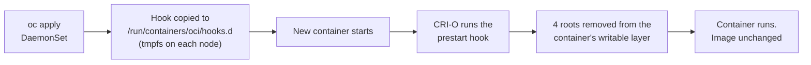

# rhsb-2026-012-crio-hook

A temporary, low-touch mitigation for RHSB-2026-012 (eMudhra CA compromise) on OpenShift
clusters that cannot be patched yet.

## The problem

Every container image ships its own CA bundle, so patching the node does not fix the pods.
In an audit of two clusters, 139 of 155 and 117 of 124 running images still trusted the
compromised roots. The OCP/RHCOS z-streams (4.12 to 4.22) are not out yet, and rebuilding
every image on the patched UBI takes time.

## How it works

A DaemonSet places an OCI prestart hook on each node. CRI-O runs the hook for every new
container, and the hook removes the 4 compromised roots from that container's own trust store.



Roots removed: emSign Root TLS CA - G3, emSign ECC Root CA - G3, emSign Root CS CA - G3,
AAA Certificate Services. Nothing else is touched, so internal CAs baked into an image stay.

Trust stores covered: RHEL/UBI, Debian/Ubuntu, Alpine and SUSE bundles, the OpenSSL hash
directory, and Python certifi. Java `cacerts` is replaced with the copy from the patched UBI 9
image. The hook always exits 0, so it never stops a container from starting.

The DaemonSet runs the cluster's own `cli` release image, which is already in every mirror
registry. Nothing new needs to be mirrored.

## Deploy and remove

```bash
IMAGE=$(oc adm release info --image-for=cli) ./deploy/render.sh   # writes rendered/rhsb-2026-012-hook.yaml
oc apply -f rendered/rhsb-2026-012-hook.yaml                      # install
oc delete -f rendered/rhsb-2026-012-hook.yaml                     # remove
```

After the install, restart the pods that make outbound TLS calls. `./test/podman-test.sh`
shows the before and after on a workstation.

## Pros and cons

| Pros | Cons |
|---|---|
| No image rebuild, no pod spec change | Only affects containers started after the install |
| No MachineConfig, no node reboot, no CRI-O restart | Does not touch roots compiled into binaries (Node.js built-in store, Rust webpki-roots, some Go distroless images) |
| No admission webhook | Custom OCI hooks are a standard CRI-O feature, but not a Red Hat supported configuration |
| Nothing new to mirror | Needs a privileged DaemonSet |
| Rollback is `oc delete -f`. The hook lives in tmpfs and is gone after a reboot | While the DaemonSet exists, it puts the hook back after every reboot |
| Keeps custom and internal CAs | |

## Tested

- podman: old ubi9, old Debian with Python (CAfile and CApath), OpenJDK 21. All went from
  exposed to blocked. redhat.com, quay.io, github.com and letsencrypt.org still connect.
- OCP 4.20 single node, SELinux enforcing: an old ubi9 pod went from HTTP 200 to `curl` rc 60
  after the DaemonSet was applied. quay.io still returned 200. No AVC denials, no CRI-O restart.
  `oc delete` removed the hook.

## When to remove it

Delete the DaemonSet once the patched OCP z-stream is rolled out and your images are rebuilt
on the current UBI (RHSA-2026:88459 for RHEL 9, RHSA-2026:88550 for RHEL 8). At that point the
hook finds nothing to remove anyway.

## Also worth doing

- Patch the oc-mirror bastion: `dnf update ca-certificates`, no reboot.
- If the egress proxy inspects TLS, remove the 4 roots from its upstream trust store. That
  covers the binaries the hook cannot reach.
- A passive firewall cannot help here: TLS 1.3 encrypts the certificate chain.
