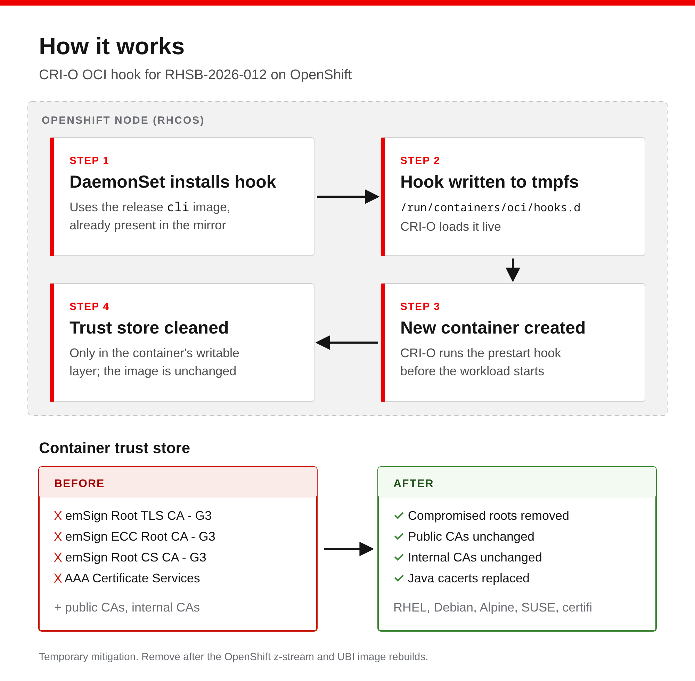

# rhsb-2026-012-crio-hook

Temporary mitigation for [RHSB-2026-012](https://access.redhat.com/security/vulnerabilities/RHSB-2026-012)
(eMudhra CA compromise) on OpenShift Container Platform clusters that cannot be updated yet.

> **Note:** This is not an official Red Hat project and is not supported by Red Hat.
> The supported fix is the patched `ca-certificates` package and the OpenShift z-stream
> that ships it.

## Overview

Each container image includes its own CA trust store. Updating the node does not change
the trust store inside running workloads, and rebuilding every image takes time.

This project installs a CRI-O OCI hook on each node. When a container is created, the hook
removes the compromised root certificates from that container's trust store. Container
images, pod specifications and node configuration are not modified.



Certificates removed:

| Root CA | SHA-256 fingerprint |
|---|---|
| emSign Root TLS CA - G3 | `7DD78D5F...2746ED8D` |
| emSign ECC Root CA - G3 | `86A1ECBA...A36BBE6B` |
| emSign Root CS CA - G3 | `F2EDAAFF...DABA34A5` |
| AAA Certificate Services | `D7A7A0FB...EA699EF4` |

Supported trust stores: RHEL and UBI, Debian and Ubuntu, Alpine, SUSE, the OpenSSL hash
directory, Python `certifi`, and Java `cacerts` (replaced with the copy from a patched
UBI 9 image).

## Prerequisites

- OpenShift Container Platform 4.x with CRI-O
- `cluster-admin` access
- `oc` and `podman` on the workstation that renders the manifest

No additional images are required. The DaemonSet uses the `cli` image from the cluster's
release payload, which is already available in disconnected mirror registries.

## Install

```bash
make deploy IMAGE=$(oc adm release info --image-for=cli)
```

The hook applies to containers created after installation. Restart workloads that make
outbound TLS connections.

## Verify

```bash
make status
```

Each line in the log shows a container ID and the trust store files that were changed.
To test locally before you install, run `make test`.

## Uninstall

```bash
make undeploy
```

Uninstall after the cluster is updated to the fixed z-stream and workload images are
rebuilt on the current UBI. After that, the hook makes no changes.

## Considerations

| Benefit | Limitation |
|---|---|
| No image rebuild or pod spec change | Applies only to containers created after install |
| No MachineConfig, node reboot or CRI-O restart | Does not change CA lists compiled into binaries (Node.js, Rust `webpki-roots`, some Go images) |
| No new images to mirror | Requires a privileged DaemonSet |
| Keeps internal and custom CAs | Custom OCI hooks are not a supported OpenShift configuration |
| Removed with `make undeploy`; hook files live in tmpfs | The DaemonSet reinstalls the hook after a node reboot until it is removed |

## Testing

| Environment | Result |
|---|---|
| podman: UBI 9 (pre-fix), Debian Python 3.11, OpenJDK 21 | Connections that use the compromised roots fail; other sites still connect |
| OpenShift 4.20, SELinux enforcing | Pod connection changed from HTTP 200 to certificate error after install; no AVC denials; no CRI-O restart |

## Related mitigations

- Update `ca-certificates` on the mirror host that runs `oc-mirror`. A reboot is not required.
- If the egress proxy inspects TLS, remove the same roots from the proxy trust store.

## License

Apache License 2.0. See [LICENSE](LICENSE).
